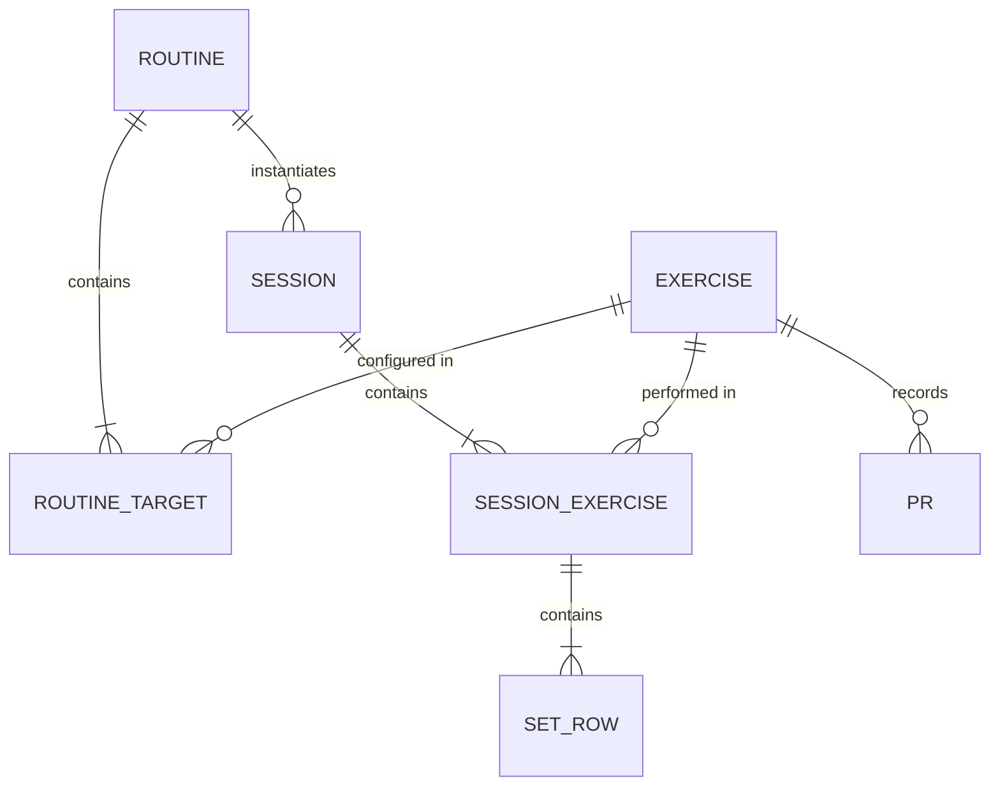
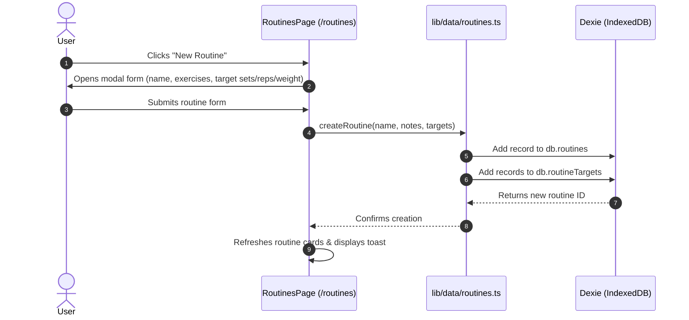
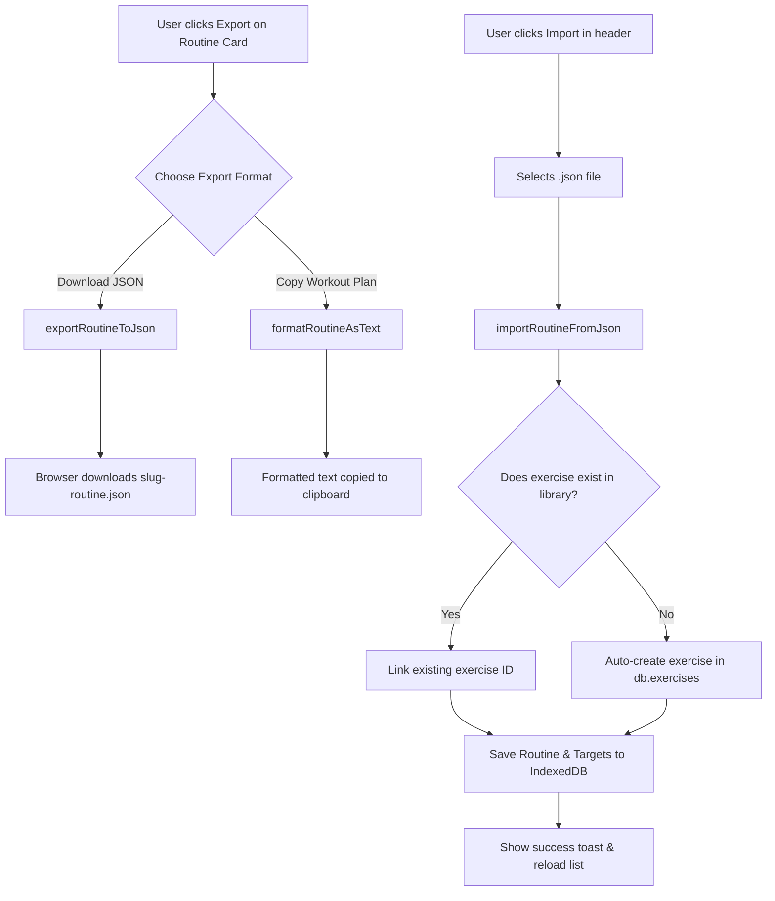
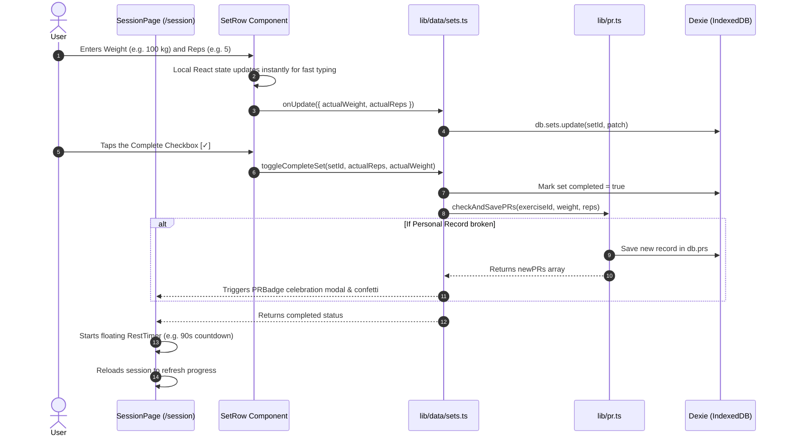

# Workout Tracker: Architecture & Flow Process Guide

Welcome to the **Workout Tracker** codebase! This guide is written specifically for beginner engineers and new contributors to help you understand how data flows through the application, how the user interface interacts with the local database, and how key features work under the hood.

---

## 1. High-Level Overview

### What is this app?
Workout Tracker is an **offline-first Progressive Web App (PWA)** designed for strength training, progressive overload tracking, and personal record (PR) logging.

### Key Architectural Principle: The "Local Vault"
Unlike standard web applications with an API server and remote database (e.g., PostgreSQL or MongoDB), this app has **zero backend server**:
- All user data (exercises, routines, completed workouts, PRs) lives **entirely in the user's browser** using **IndexedDB**.
- We use **[Dexie.js](https://dexie.org/)** as an ergonomic wrapper around the browser's native IndexedDB API.
- Works 100% offline in gym basements or airplane mode with instant reads and writes (0ms network latency).

### Technology Stack
- **Framework**: Next.js 16 (App Router)
- **UI Library**: React 19
- **Styling**: Tailwind CSS v4
- **Database**: Dexie.js (IndexedDB)
- **Icons**: Lucide React
- **Unit Testing**: Vitest + `fake-indexeddb`

---

## 2. The Data Model (Mental Model)

Before diving into the code, understand the relationship between our 5 core concepts:



### The Entities in Plain English
1. **`Exercise`** (`src/lib/types.ts`):
   A movement catalog item (e.g., *Barbell Deadlift*, target body part: *Back*, equipment: *Barbell*).
2. **`Routine` & `RoutineTarget`**:
   The **blueprint/template** for a workout (e.g., *Pull Day*). It specifies which exercises you plan to do, and your default targets (e.g., 3 sets of 5 reps @ 100 kg).
3. **`Session`**:
   An **actual gym event** that took place (e.g., *Gym workout on Oct 23 at 2:00 PM*). Can be started from a Routine or as an ad-hoc Empty Workout.
4. **`SessionExercise` & `SetRow`**:
   The exercises and individual sets logged during a live session. Each `SetRow` stores both **target** numbers and **actual** numbers logged by the user, plus flags for warmup (`isWarmup`) and completion (`completed`).
5. **`PR` (Personal Record)**:
   An achievement record automatically detected when a user hits a new max weight, estimated 1-rep max (e1RM), or volume for an exercise.

---

## 3. End-to-End Application Flows

---

### Flow 1: Creating & Managing Routine Templates

**Where it happens**: `src/app/routines/page.tsx` & `src/lib/data/routines.ts`



#### Key Implementation Details:
- **Hydration**: Routines and their targets are stored in separate tables (`routines` and `routineTargets`). The function `getAllRoutines()` joins them together with their corresponding `Exercise` objects so the UI receives a complete `HydratedRoutine`.
- **Validation**: Empty or string inputs are sanitized into valid numbers (`Math.max(1, parseInt(...))`) before saving.

---

### Flow 2: Exporting & Importing Routines

**Where it happens**: `src/app/routines/page.tsx` & `src/lib/data/routines.ts`

Users can export routines to share with others or transfer between browsers.



#### Why auto-creating exercises on import is important:
If a user imports a routine with an exercise they don't have yet (e.g., *Bulgarian Split Squat*), `importRoutineFromJson()` detects that it is missing and automatically creates the exercise in `db.exercises` so the routine works out-of-the-box.

---

### Flow 3: Starting a Workout Session

**Where it happens**: `src/app/page.tsx`, `src/app/routines/page.tsx`, `src/app/session/page.tsx`

There are two entry points to start a workout:
1. **Quick Start (Empty Workout)**:
   Calls `createEmptySession()`. Creates a fresh `Session` record with no exercises. The user adds exercises on the fly.
2. **Launch from Routine Template**:
   Calls `createSessionFromRoutine(routineId)`.

#### What happens inside `createSessionFromRoutine(routineId)`:
1. Reads the routine blueprint and targets from IndexedDB.
2. Creates a new `Session` record with `finished: false`.
3. For each target exercise:
   - Creates a `SessionExercise` record.
   - Looks up the user's **historical performance** using `getLastTimeSets()`.
   - Creates `SetRow` records pre-filled with the routine targets (or previous weights).
4. Navigates the router to `/session?id=<new_session_id>`.

---

### Flow 4: The Live Workout Session (`/session`)

**Where it happens**: `src/app/session/page.tsx` & `src/components/SetRow.tsx`

This is the primary screen where the user logs their workout in real-time.



#### Key Components on the Session Screen:
- **`SetRow`**:
  Responsive row designed for zero distortion. On mobile devices, set info (Set #, Warmup tag, Target, Last time) sits in a top header line, while steppers (`-` / `+`) and the large completion toggle sit in a spacious bottom row.
- **`RestTimer`**:
  Starts automatically whenever a set is marked complete. Plays a gentle alert tone and vibrator when time expires.
- **`PRBadge`**:
  Fires celebratory confetti (`canvas-confetti`) when a PR is achieved (e.g., New Max Weight, New Volume Record, or New Estimated 1RM).
- **`WakeLockManager`**:
  Uses the browser's `navigator.wakeLock` API to keep the smartphone screen awake while lifting.
- **Export from Active Workout**:
  Users can tap "Export Routine" to snapshot an ad-hoc empty workout into a permanent routine template via `createRoutineFromSession()`.

---

### Flow 5: Finishing a Workout & Viewing History

**Where it happens**: `src/app/session/page.tsx` & `src/app/history/page.tsx`

1. User clicks **"Finish Workout"**.
2. `finishSession(sessionId)` is called:
   - Sets `session.finished = true`.
   - Calculates duration (`session.durationSeconds = (now - session.date)`).
3. Router redirects to `/history`.
4. `/history` loads all finished sessions and computes analytics:
   - **Total Volume (kg)** = $\sum (\text{actualWeight} \times \text{actualReps})$ across all completed non-warmup sets.
   - List of completed exercises with set breakdowns.
5. **Backup Nudge**:
   If the user hasn't exported their local IndexedDB database in the last 7 days, a data protection nudge banner appears reminding them to export a JSON backup via `exportDatabaseToJson()`.

---

## 4. Codebase Directory Map

```text
src/
├── app/                      # Next.js App Router Pages
│   ├── page.tsx              # Home Dashboard (Quick start, recent PRs, stats)
│   ├── layout.tsx            # Root HTML layout, theme, and font setup
│   ├── session/page.tsx      # Live workout logger
│   ├── routines/page.tsx     # Routine template manager & export/import
│   ├── library/page.tsx      # Exercise catalog (search, filter, create)
│   ├── history/page.tsx      # Completed workouts history & volume logs
│   ├── settings/page.tsx     # Unit switcher (kg/lb), backup/restore, seed data
│   └── exercise/page.tsx     # Single exercise detail & PR progress charts
│
├── components/               # Reusable UI Components
│   ├── SetRow.tsx            # The core logging row (steppers, inputs, complete)
│   ├── Navigation.tsx        # Persistent bottom tab bar & active workout resume banner
│   ├── RestTimer.tsx         # Rest interval timer with sound and vibration
│   ├── PRBadge.tsx           # PR milestone pop-up with confetti
│   ├── PRCard.tsx            # Exercise PR display cards
│   ├── AchievedSummary.tsx   # Exercise completion verdict dialog
│   ├── WakeLockManager.tsx   # Screen wake lock toggle
│   └── AppInit.tsx           # Initial database seeder for first-time visitors
│
└── lib/                      # Business Logic & Database Layer
    ├── db.ts                 # Dexie database instance & table schema definitions
    ├── types.ts              # TypeScript interfaces for all database records
    ├── units.ts              # Weight conversion helpers (kg <-> lb)
    ├── backup.ts             # Full database JSON export/import & CSV export
    ├── pr.ts                 # PR calculation logic (Brzycki 1RM formula, volume)
    └── data/                 # High-level database query functions
        ├── exercises.ts      # Exercise CRUD operations
        ├── routines.ts       # Routine CRUD, export to JSON/text, import
        ├── sessions.ts       # Session creation, hydration, finish, delete
        ├── sets.ts           # Set row updates, toggle complete, PR triggers
        └── settings.ts       # User preference getters and setters
```

---

## 5. Important Engineering Principles to Remember

### 1. The Weight Unit Rule: Always Store in Kilograms (KG)
- In the database (`db.sets`, `db.routineTargets`, `db.prs`), weights are **always stored in kilograms (`kg`)**.
- When the user selects **`lb`** in Settings:
  - We use `toDisplayWeight(kg, 'lb')` to convert for display and inputs.
  - We use `toStoredKg(displayVal, 'lb')` before saving back to Dexie.
- **Why?** This prevents unit mismatches and corrupted calculations if a user switches back and forth between metric and imperial.

### 2. Database Transactions for Relational Safety
When creating or deleting items with relationships (e.g., deleting a routine and all its targets), always wrap the operation in a Dexie transaction:
```ts
await db.transaction('rw', [db.routines, db.routineTargets], async () => {
  await db.routineTargets.where('routineId').equals(id).delete();
  await db.routines.delete(id);
});
```
This ensures that if anything fails, changes roll back cleanly without leaving orphaned records.

### 3. Client Components & Hydration
Because IndexedDB only exists in the browser (`window.indexedDB`), all pages and components that interact with the database must have `'use client';` at the top of the file.

### 4. Running Tests
We use Vitest with `fake-indexeddb` to test database operations in Node.js without needing a browser:
```bash
# Run all tests
npm test

# Run a specific test file
npx vitest run test/routines.test.ts
```

---

## 6. Summary Checklist for Adding New Features
1. **Changing Database Schema?** Update `src/lib/types.ts` and `src/lib/db.ts` (remember to bump the Dexie version number if changing schema keys).
2. **Adding Data Methods?** Put queries in `src/lib/data/<domain>.ts`.
3. **Writing UI Components?** Ensure mobile responsiveness first (touch tap targets should be at least 36px to 44px).
4. **Validating?** Add a unit test in `test/<domain>.test.ts` and run `npm test`.
